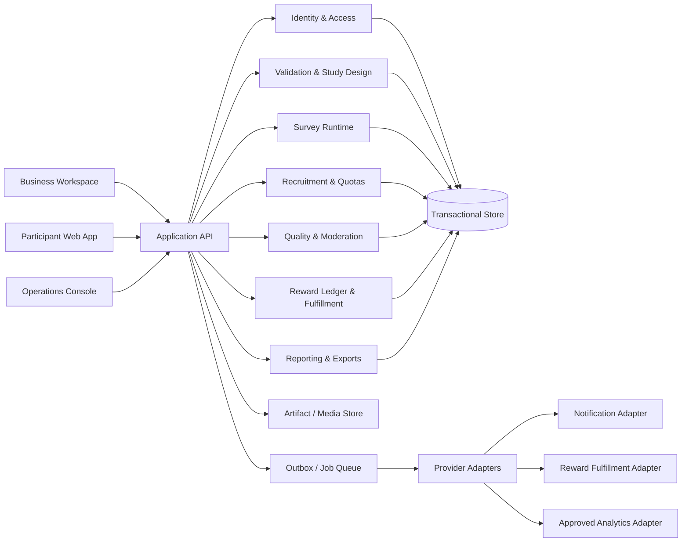

# Technical Architecture

**Version:** 0.1  
**Architecture posture:** capability-based, modular, observable, and provider-portable.  
**Hosting and payment providers:** deliberately unselected pending compliance and commercial validation.

## 1. System boundaries

Build around business capabilities, not one vendor's product vocabulary. External systems must be replaceable behind explicit interfaces.

## 2. Core modules

### Identity and organization access

- Authenticate users and manage sessions.
- Enforce organization, project, and role boundaries at the service/data-access layer.
- Separate participant identity attributes from response content.
- Use auditable elevated support access rather than routine administrator access to all data.

### Project validation

- Store project context, decision, hypotheses, alternatives, constraints, and evidence references.
- Version the study contract and decision thresholds.
- Link claims to runs/results and record why their statuses changed.

### Study and survey engine

- Manage study version, questions, options, logic rules, screeners, quotas, published state, and fieldwork window.
- Published survey versions are immutable; edits create a new version.
- Validate logic graphs for unreachable questions, invalid branches, and loops before publication.
- Renderer consumes a versioned questionnaire schema; avoid arbitrary executable scripts authored by customers.

### Recruitment and quota management

- Resolve eligible campaigns against minimal participant profile attributes.
- Reserve a campaign slot/attempt transactionally to prevent race-driven over-enrollment.
- Track invitations, starts, submissions, screen-outs, quota closure, and completion.
- Avoid exposing exact internal fraud heuristics to respondents.

### Quality and moderation

- Produce interpretable quality signals with reason codes and evidence.
- Distinguish automatic hard constraints (e.g., already-submitted participant/study pair) from probabilistic flags (e.g., unusually short completion time).
- Support human decisions, reason capture, appeals, and policy-version tracking.
- Never use one signal as sole basis for irreversible permanent bans or financial forfeiture.

### Reward accounting and fulfillment

- Keep a durable internal ledger of obligations and outcomes; do not represent it as stored-value money.
- Track reward unit/value, currency where applicable, campaign source, status, fulfilment reference, idempotency key, retries, and reconciliation.
- External provider integration via an adapter with a sandbox/test mode and explicit capability declaration.
- Prevent double fulfillment with idempotency and unique constraints.

### Reporting and exports

- Build aggregate results from a frozen analysis snapshot tied to survey version and dataset version.
- Record exclusions and transformations used in each report.
- Default to aggregate reports. Raw answer export requires explicit project permission, clear purpose, and audit logging.
- Protect small cells from re-identification; apply minimum cell suppression rules.

### Operations and compliance

- Campaign review, user/report moderation, reward reconciliation, support disputes, deletion requests, incident management, data-access logging, and audit review.

## 3. Domain model (conceptual)

| Entity | Purpose / important fields |
|---|---|
| User | Login identity, status, locale, created_at; keep profile attributes separate. |
| ParticipantProfile | Optional research attributes, consent/preferences, last_verified_at, source, retention metadata. |
| Organization | Business workspace, legal/business details when necessary, status. |
| Membership | User, organization, role, scope, inviter, state. |
| Project | Business idea/product/service context, owner organization, stage, status. |
| DecisionContract | Decision, hypotheses, target population, measures, thresholds, sampling design, risks, version. |
| Hypothesis | Statement, evidence status, confidence rationale, linked evidence, history. |
| Study | Campaign, purpose, target criteria, geography, dates, target completes, status, budget reference. |
| SurveyVersion | Immutable question tree/schema, language/register, version, validation outcome, published_at. |
| Question / Option | Type, wording, constraints, display logic, required state, option values. |
| QuotaCell | Segment/geography/criteria, planned count, achieved count, closure state. |
| Participation | Participant pseudonymous ID, study/version, screening result, workflow state, timestamps. |
| Answer | Participation ID, question ID, normalized answer, encrypted/pseudonymous linkage; access-restricted. |
| QualityAssessment | Signals, policy version, reason codes, assessment state, reviewer decision. |
| RewardObligation | Participant/study, item/value, approval condition, payable status, due_at. |
| RewardLedgerEntry | Immutable accounting event, type, amount/unit, source, idempotency key, reference. |
| FulfillmentAttempt | Provider/method, attempt number, request reference, result, retry state. |
| ProductTestRun | Protocol version, item/access delivery, task completion, evidence, incident/return state. |
| ReportSnapshot | Dataset/instrument versions, transformations, aggregates, methodology, exported artifacts. |
| ConsentRecord | Purpose, notice version, consent choice, timestamp, collection context; where consent is the basis. |
| ProcessingActivity | Purpose, data categories, recipients/processors, legal basis, retention, transfers, safeguards. |
| AuditEvent | Actor, action, object, timestamp, reason, outcome; avoid storing unnecessary sensitive values in logs. |

## 4. Data segregation and tenant isolation

- Every business-owned entity includes an organization scope or derives it through a strict parent relation.
- Service methods enforce membership and permission checks; UI hiding is not authorization.
- Participant identity and answer content are separated. Business customers see pseudonymous or aggregate data by default.
- Reward operators see necessary fulfillment identifiers but not response content unless a documented support case requires it.
- Moderators see only data needed for a review; all exceptional access is logged.
- Tenant identifiers are included in uniqueness and access checks to prevent cross-tenant collisions or leakage.

## 5. Main state machines

### Study

`draft -> review_pending -> approved -> scheduled/open -> paused -> closed -> analysis_pending -> reported -> archived`

Rejected/withdrawn states need a reason. Pausing must stop new starts while allowing the configured handling of active sessions.

### Participation

`invited/discoverable -> screening -> eligible -> in_progress -> submitted -> under_review -> accepted | rejected -> appealed (optional) -> final_decision`

Accepted participation creates a reward obligation, not immediate fulfillment. Reward fulfillment is a separate state machine.

### Reward

`not_earned -> due -> approved -> fulfillment_pending -> fulfilled`

Exception states: `held_for_review`, `failed_retryable`, `disputed`, `reversed_with_reason`, `cancelled_under_policy`. All transitions require actor/policy reason and idempotency controls.

## 6. API boundaries

Expose versioned application APIs around business operations, not generic database mutation:

- Projects: create/update project, define decision contract, manage hypotheses.
- Studies: draft, validate, submit for review, publish, pause, close.
- Survey sessions: fetch immutable survey version, screen, save progress, submit once.
- Recruitment: inspect opportunity, reserve slot, enforce quotas, stop when cap reached.
- Quality: assess, review, accept/reject with reasons, appeal.
- Rewards: calculate obligation, reconcile campaign budget, request fulfillment, reconcile provider callback.
- Reports: freeze analysis snapshot, query permitted aggregates, request/export artifact.
- Privacy: access/export/correction/deletion requests, consent history, processing register.
- Operations: moderation and audit queries with role restrictions.

All write operations that may be retried use idempotency keys or equivalent deterministic deduplication.

## 7. Storage and asynchronous work

- **Transactional store:** relational transactional persistence for identities, projects, studies, answers, quotas, and reward ledger. Use transactions for quota reservation, final submission, and reward obligation creation.
- **Artifact store:** exports, images, product-test evidence, and report files behind a BlobStore capability; enforce short-lived authorized access and retention/deletion.
- **Job processing:** notifications, analytics snapshots, exports, reward requests, and reconciliation via a durable outbox/queue. Never rely on an in-memory background promise for money/reward operations.
- **Search/analytics:** begin with database-supported queries and materialized aggregates; add a separate analytical store only when measured load and privacy review justify it.
- **Cache:** cache public survey definitions and non-sensitive reference data only; never let stale cached permissions authorize access.

## 8. Security and resilience requirements

- TLS in transit; encryption at rest where supported and managed securely.
- Managed secrets, least-privilege service credentials, regular rotation, no secrets in code or logs.
- Rate limits on login, screening, starts, submissions, exports, and reward operations.
- CSRF/XSS/injection defenses, content security policy, server-side validation, safe upload handling, and dependency scanning.
- Backups with documented recovery point/recovery time objectives and periodic restore tests.
- Audit logs append-only or tamper-evident for material administrative and reward events.
- Incident response: detect, contain, investigate, notify/repair according to reviewed obligations.
- No third-party session replay, ad tracking, or AI transfer of raw answers by default.

## 9. Portability interfaces

Define interfaces for:
- `IdentityProvider`
- `TransactionalStore`
- `BlobStore`
- `JobQueue`
- `NotificationProvider`
- `RewardFulfillmentProvider`
- `PaymentCollectionProvider` (only after legal/provider review)
- `AnalyticsProvider`
- `Clock` and `IdGenerator` for deterministic tests

Use contract tests for adapters. Core domain logic must not depend directly on a vendor SDK or provider-specific response formats.

## 10. Hosting and release strategy

No hosting provider is preselected. Choose only after documenting data categories, data location, backups, subprocessors, support access, transfer mechanisms, and ANPDP/legal requirements. A technically convenient hosting choice is not automatically a legally approved data-processing location.

Environments: local/test, staging with synthetic data, production. Production data must not be copied to staging unless specifically minimized, protected, and authorized. Feature flags may control pilot workflows but cannot bypass server-side permissions or consent.

Release gate: tests, migrations and rollback plan, security/privacy review, backup/restore evidence, smoke tests, and operational ownership documented.

## 11. Architecture decisions intentionally left open

- Exact web framework and database implementation.
- Hosting/data residency and processor agreements.
- Payment/reward provider and merchant contract.
- Identity verification level beyond minimal account controls.
- Whether to adopt a dedicated analytics store.
- Whether product-test logistics need a partner integration.

These are decisions gated by legal review, measured pilot load, and operational evidence, not hidden assumptions.
